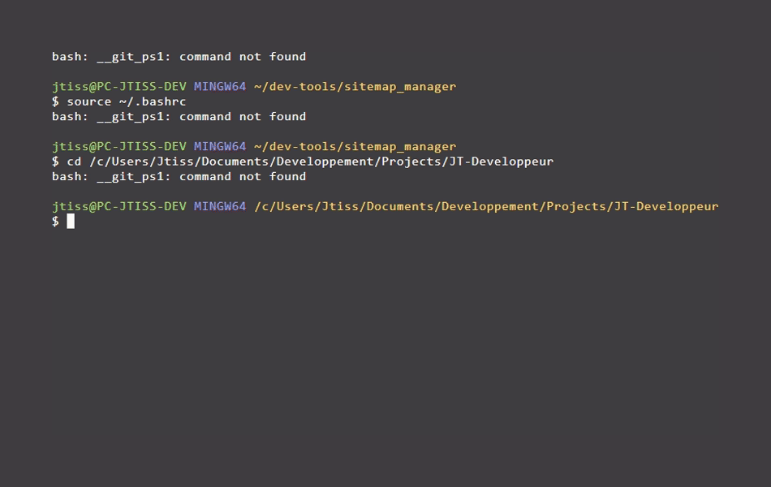

# Sitemap Manager

`sitemap_manager.sh` est un utilitaire en ligne de commande (Bash) conçu pour simplifier la gestion et la mise à jour dynamique du fichier `sitemap.xml` d'un projet web.

---

## 💡 Fonctionnalités

- 📅 **Mise à jour interactive des balises `<lastmod>`** : Parcourt les URLs de votre `sitemap.xml` et applique la date du jour aux pages modifiées.
- 🧹 **Nettoyage automatique des caractères de fin de ligne** : Prise en charge transparente des fins de ligne Windows (`\r`) et UNIX (`\n`).
- 🛡️ **Écriture sécurisée** : Utilise un fichier temporaire pour éviter la corruption du sitemap original en cas d'erreur de traitement.
- 📋 **Menu interactif** : Interface simple en ligne de commande pour enchaîner les opérations.

---

## 📋 Prérequis

- Un environnement UNIX / Linux / macOS ou Git Bash sous Windows.
- Les utilitaires standards suivants installés : `bash`, `awk`, `grep`, `sed`, `tr`.
- Un fichier `sitemap.xml` valide présent dans le répertoire de travail depuis lequel le script est exécuté.

---

## 🚀 Installation & Utilisation

### 1. Chargement du script

Pour utiliser les fonctions dans votre terminal courant, chargez le script avec la commande `source` (ou `.`) :

```bash
source sitemap_manager.sh
```

### 2. Lancement du menu principal

Exécutez simplement la fonction :

```bash
sitemap_manager
```

### 3. Affichage de l'aide

Pour afficher la description et les commandes disponibles :

```bash
sitemap_help
```

---

## 📖 Exemple d'utilisation



---

## 🚧 Roadmap (Fonctionnalités à venir)

- [ ] Ajout dynamique d'une nouvelle URL dans le fichier XML.
- [ ] Édition et suppression d'URLs existantes.
- [ ] Mode "Mise à jour globale" (pour mettre à jour toutes les dates sans validation individuelle).